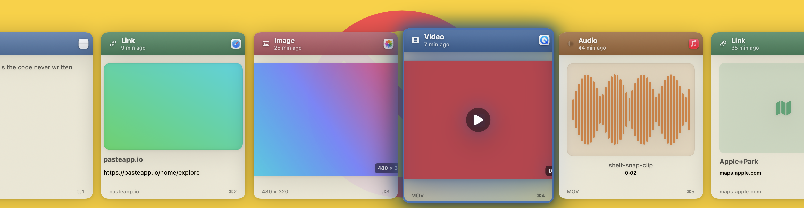
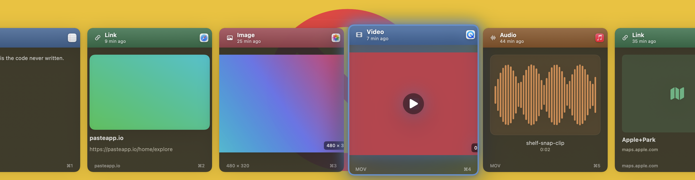

<div align="center">

# Shelf

**Your clipboard, with superpowers.**

A native macOS clipboard manager — a keyboard-first, horizontal carousel of live
preview **cards** (not a boring text list) on a translucent glass shelf pinned to
the bottom of your screen.

[](https://github.com/yindia/shelf/actions/workflows/ci.yml)
[](https://github.com/yindia/shelf/releases/latest)
[](https://www.apple.com/macos/)
[](https://www.swift.org)
[](LICENSE)




</div>

> Inspired by [Paste](https://pasteapp.io/), but an independent implementation:
> Shelf contains **no** code, assets, or measurements from it, and uses its own
> name, icon, geometry, palette, and design tokens.

---

## Why Shelf

Everything you copy — text, links, images, files, colors, code — lands on a fast,
keyboard-first glass shelf. Find anything instantly (including text **inside**
screenshots), preview with Quick Look, organize into pinboards, and paste it back
anywhere. Built with AppKit + SwiftUI and Swift 6 strict concurrency; **local-first**
with **opt-in** iCloud sync.

## Highlights

- 🗂 **Rich preview cards** per content type — text, rich text/HTML, code
  (syntax-highlighted), images (thumbnail + dimensions), video (poster + duration),
  audio (artwork/waveform), links (thumbnail + page title + domain), maps, colors
  (the card fills with the copied swatch), and files.
- 🔎 **Power Search** — fuzzy, typo-tolerant ranking with **inline filter tokens**:
  type to narrow by content **type**, source **app**, **date**, or **pinboard** via
  an autocomplete dropdown (OR within a filter, AND across filters). Searches text,
  titles, URLs, and **OCR text from images**, with an on-device **semantic**
  fallback that finds clips by meaning when there's no exact match.
- 🧩 **Apple Intelligence** (on-device, private, free, macOS 26+) — smart **titles
  & summaries** for long clips, AI **auto-categorization** of ambiguous text, and
  **Writing Tools** (Rewrite / Proofread / Summarize) in the editor. Degrades
  gracefully on Macs without Apple Intelligence.
- 🏷 **Multi-category** — an item can live in several pinboards at once (**Add to
  Category**), not just move between them.
- 🧲 **Paste Stack** — press **⇧⌘C** to stack copies, then **⌘V** pastes them one by
  one, top-to-bottom, across any apps. Reorder or remove items in a floating window.
- 🧠 **Auto-categorization** — new clips file themselves into Links, Notes, Code,
  Images, Colors, Files, and Media automatically. Clipboard History always shows all.
- 🔒 **Privacy-first** — hide from screen sharing, skip confidential content, exclude
  apps, and set a retention window. Pinned items are always kept.
- ☁️ **Opt-in iCloud sync** — mirror your history across Macs (CloudKit-entitled build).
- ⌨️ **Keyboard-first & native** — real `NSVisualEffectView` glass, continuous corners,
  VoiceOver labels, and Reduce Transparency / Motion / Increase Contrast support.

## Keyboard shortcuts

| Shortcut | Action |
| --- | --- |
| **⇧⌘V** | Open / dismiss the shelf |
| **⌃⌘V** | Open the Spotlight-style search |
| **⇧⌘C** | Toggle Paste Stack |
| **← →** | Move selection · **⌘1–9** pick & paste |
| **⏎** | Paste selected · **⇧⏎ / ⌥** paste as plain text |
| **Space** | Quick Look · **⎋** dismiss |
| **⌘F** | Search · **⌘G** jump to item in its collection |
| **⌘O** | Open link · **⌘N** new text item · **⌘T** pause/resume |
| **⌘,** | Settings |

## Install

### Homebrew (recommended)

```bash
brew tap yindia/shelf https://github.com/yindia/shelf
brew install --cask shelf
```

Upgrade with `brew upgrade --cask shelf`. The cask clears the Gatekeeper
quarantine flag automatically (builds are ad-hoc signed, not notarized).

### Direct download

Grab **Shelf.dmg** from the [latest release](../../releases/latest), open it, and
drag **Shelf** to Applications.

> Builds are **ad-hoc signed, not notarized**, so Gatekeeper warns on first run.
> Right-click **Shelf.app → Open** once, or run
> `xattr -dr com.apple.quarantine /Applications/Shelf.app`.

## First launch

1. A **Shelf** icon appears in the menu bar (no Dock icon by design).
2. Grant **Accessibility** when prompted — **System Settings ▸ Privacy & Security ▸
   Accessibility → enable Shelf**. It's required for paste-back (synthetic ⌘V) and
   Paste Stack. Capture and the UI work without it.
3. Copy a few things, then press **⇧⌘V** to open the shelf.

<details>
<summary><b>Troubleshooting permissions</b></summary>

After an update, paste-back may stop working and Console may log
`"... lost access to protected data"`. The ad-hoc signature changed, so macOS
(TCC) dropped the old Accessibility grant. To restore it:

```bash
tccutil reset Accessibility com.yindia.shelf
```

Then relaunch and re-enable Shelf under Privacy & Security ▸ Accessibility. A
Developer ID signature would make the grant survive updates.
</details>

## Build from source

Requirements: **macOS 14+** and **Swift 6** (Xcode 16+ or the standalone
toolchain; `swift --version` → `6.x`). No paid Apple Developer account needed for
local runs — the Makefile ad-hoc-signs.

```bash
make test     # run the Core unit tests
make run      # build, bundle into Shelf.app, ad-hoc sign, and launch
make dmg      # package build/Shelf.dmg
```

SPM resolves the three local packages by relative path — no network fetch. You can
also open the root `Package.swift` in Xcode (use `make run` for the real agent `.app`).

## Architecture

Capture → classify → dedup → store → render → paste-back.

```
App/                     Agent app target (LSUIElement, no Dock icon)
  AppDelegate            Status item, global hotkeys, panel/stack/settings wiring
  AppEnvironment         Composition root (no global singletons)
  PanelController        Floating NSPanel + SwiftUI host + key monitor
  PasteStackController   Paste Stack window + global ⌘V event tap
  SettingsWindowController  Unified settings window
Packages/
  Core/      UI-free, platform-free, unit-tested: Model, Classifier,
             Fingerprint (SHA-256), CoreData store, Repository, CaptureManager,
             PowerSearch, SearchSuggestions, PasteStackModel
  Platform/  NSPasteboard I/O, CGEvent paste-back, Carbon hotkeys, AX, ⌘V tap
  UI/        Theme (all tunable constants), cards, carousel, Power Search tokens,
             spotlight, settings panes, view models
```

- **Capture:** a `DispatchSourceTimer` (~0.3 s) polls `NSPasteboard.changeCount`,
  classifies the content, SHA-256 dedups, and writes to CoreData. Skips
  `org.nspasteboard.ConcealedType` / `TransientType` and excluded apps.
- **Sync:** opt-in `NSPersistentCloudKitContainer`, falling back to a local store
  when CloudKit isn't entitled.
- **Intelligence:** `ClipIntelligence` protocol in `Core`; a `FoundationModels`
  implementation in `Platform` behind `#if canImport(FoundationModels)` (compiles
  out on older SDKs) with a no-op fallback. Semantic search uses `NLEmbedding`.
- **Tuning:** all card geometry, materials, motion, and palette live in
  `Packages/UI/Sources/UI/Theme.swift`.

## Releases

Pushing a `v*` tag runs `.github/workflows/release.yml`, which tests, builds a
universal (arm64 + x86_64) binary, packages the DMG, and publishes a GitHub Release.

```bash
git tag v0.1.0 && git push origin v0.1.0
```

For a warning-free install on other machines, sign with a **Developer ID
Application** certificate and **notarize** + **staple** the app/DMG. iCloud sync
likewise requires a CloudKit-entitled, Developer ID signed build.

## Contributing

See [CONTRIBUTING.md](CONTRIBUTING.md). CI builds and runs the Core tests on macOS
for every PR.

## License

[MIT](LICENSE) © Shelf contributors.
